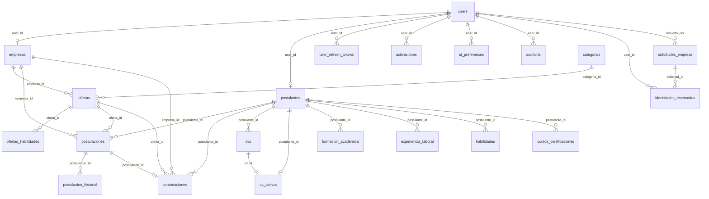

# Base de datos y migraciones

> Sincronizado con SOL **1.5.4** (2026-11-07).

Documento de referencia del esquema MariaDB real de SOL. La fuente de verdad son
las migraciones de `backend/app/Database/Migrations/`; este documento las
resume y describe las relaciones vigentes. No se deben editar migraciones
históricas para “cuadrar” la documentación.

## 1. Principios

- Motor: MariaDB 11.4.13, tablas InnoDB, `utf8mb4` y `utf8mb4_general_ci`.
- CodeIgniter 4 es el único componente que accede a MariaDB mediante el driver `MySQLi`.
- Los registros de negocio no se eliminan físicamente: se desactivan o se
  conservan con marcas históricas.
- Las claves foráneas y los índices únicos son parte de las reglas de negocio,
  no solo del rendimiento.
- `America/Lima` es la zona de negocio; las columnas de fecha/hora se guardan
  como valores locales de esa zona.
- Las tablas `*_legado` conservan información histórica y no participan en los
  flujos operativos actuales.

## 2. Diagrama entidad-relación



`actividades`, `oportunidades`, `rate_limit_contadores`, las tablas legado y
`atenciones` no tienen relaciones activas con el resto del modelo. Se mantienen
fuera del diagrama para no sugerir vínculos inexistentes.

## 3. Tablas principales

### Identidad y acceso

| Tabla | Clave / restricciones | Uso |
|---|---|---|
| `users` | PK `id`; `username` único; `rol` ENUM `admin/empresa/postulante`; `perfil_municipal` ENUM `admin/moderador/solo_lectura` nullable; `estado` ENUM `activo/inactivo` | Cuenta de acceso. El rol y el estado son la autoridad; el JWT solo transporta el id. |
| `user_refresh_tokens` | PK `id`; `token_hash` único; FK `user_id` → `users` | Refresh tokens con hash SHA-256, expiración y revocación. |
| `activaciones` | PK `id`; `token_hash` único; FK `user_id` → `users` | Enlaces de un solo uso para activar cuentas empresariales. |
| `identidades_reservadas` | PK `id`; único `(tipo, valor)`; FK `user_id`/`solicitud_id` | Reserva global de correo, teléfono, RUC y DNI; `estado=conflicto` documenta duplicados históricos. |
| `solicitudes_empresa` | PK `id`; `ruc_reservado` generado + único para estados activos; FK `resuelto_por` → `users` | Auto-registro empresarial; conserva solicitudes rechazadas/aprobadas. |
| `ui_preferences` | PK `user_id`; FK `user_id` → `users` | Tema y modo claro/oscuro/sistema por usuario. |
| `auditoria` | PK `id`; FK `user_id` → `users` `SET NULL` | Trazabilidad de acciones administrativas y de seguridad. |

El detalle histórico del backfill de identidades y los conflictos detectados está
en [`identidad-conflictos.md`](identidad-conflictos.md).

### Empresas y postulantes

| Tabla | Clave / restricciones | Uso |
|---|---|---|
| `empresas` | PK `id`; `user_id` único; `ruc` único; `logo_key`; presencia digital | Perfil empresarial; el RUC es el identificador de acceso y el correo es contacto/recuperación. |
| `postulantes` | PK `id`; `user_id` único; `dni` único; `tipo_documento`; `foto_key`; datos de contacto y perfil laboral | Perfil del ciudadano. |
| `cvs` | PK `id`; FK `postulante_id`; índice `(postulante_id, activo)` | Metadatos de cada versión de CV; el archivo vive en Storage. |
| `cv_activos` | PK `postulante_id`; `cv_id` único; FKs a `postulantes` y `cvs` | Garantiza un único CV activo por postulante. |

Las tablas `formacion_academica`, `experiencia_laboral`, `habilidades` y
`cursos_certificaciones` siguen creadas por migraciones históricas, pero el
producto ya no las usa. No se eliminan sin confirmación de que no contienen
datos reales.

### Ofertas, postulaciones y contrataciones

| Tabla | Clave / restricciones | Uso |
|---|---|---|
| `categorias` | PK `id`; `nombre` único | Catálogo de categorías de ofertas. |
| `ofertas` | PK `id`; FK `empresa_id`, `categoria_id`, `validado_por`; índices de empresa/estado/fecha | Oferta laboral y revisión municipal. `fecha_publicacion` se asigna al aprobar. |
| `ofertas_habilidades` | PK `id`; único `(oferta_id, habilidad)`; FK `oferta_id` | Habilidades normalizadas de la oferta. |
| `postulaciones` | PK `id`; FKs a postulante, oferta y empresa; `postulacion_unica` generada + única; `activo`; `retirada_postulante` | Postulación individual. Solo una activa por postulante/oferta. |
| `postulacion_historial` | PK `id`; FK `postulacion_id`; FK `usuario_id` → `users` | Historial de estados; el usuario es `users.id`, no `postulantes.id`. |
| `contrataciones` | PK `id`; `postulacion_id` único; FKs a empresa, oferta y postulante; `situacion_laboral`, `motivo_situacion`, `fecha_situacion` | Resultado contractual del proceso. |

### Actividades y oportunidades

| Tabla | Clave / restricciones | Uso |
|---|---|---|
| `actividades` | PK `id`; `tipo` ENUM; `estado` ENUM; `imagen_key`; `enlace`; índices por tipo/fecha | Ferias, eventos, talleres y capacitaciones. El estado efectivo se calcula por fecha. |
| `oportunidades` | PK `id`; `fuente` ENUM; `estado` ENUM; `fecha_inicio`, `fecha_fin`, `modalidad`; `activo` | Difusión externa. Sin `fecha_publicacion` ni `empresa_id`: ambos fueron retirados. Visibilidad pública independiente de la fecha de inicio. |
| `oportunidades_fecha_publicacion_legado` | Tabla de archivo | Conserva los valores históricos de la columna retirada. |

### Soporte de rate limiting

| Tabla | Clave / restricciones | Uso |
|---|---|---|
| `rate_limit_contadores` | PK compuesta `(clave, ventana_inicio)`; índice por `ventana_inicio` | Contadores de ventana fija para CV. No guarda historial de cargas. |
| `cv_cuotas_mensuales_legado` | Tabla histórica | Antigua cuota mensual de CV, retirada del flujo operativo. No confundir con los contadores de rate limiting. |

### Tablas retiradas o sin uso

- `atenciones`: módulo de atención/orientación retirado.
- `formacion_academica`, `experiencia_laboral`, `habilidades`,
  `cursos_certificaciones`: secciones de perfil retiradas.
- `cv_cuotas_mensuales_legado`: histórico de la cuota mensual de CV.
- `oportunidades_fecha_publicacion_legado`: archivo de la fecha editorial de
  oportunidades.

## 4. Reglas de integridad relevantes

- `users.username`, `empresas.ruc`, `postulantes.dni`, `identidades_reservadas`
  `(tipo, valor)` y `solicitudes_empresa.ruc_reservado` impiden duplicados.
- `postulaciones.postulacion_unica` es una columna virtual generada:
  `postulante_id-oferta_id` cuando `activo=1`; NULL cuando está inactiva. La
  unicidad solo aplica a postulaciones activas.
- `contrataciones.postulacion_id` es único: una postulación no puede tener más
  de una contratación.
- `cv_activos` tiene PK `postulante_id` y `cv_id` único.
- Las FKs usan `CASCADE` en dependencias directas y `SET NULL` en referencias
  históricas/opcionales (por ejemplo, `auditoria.user_id` y
  `postulacion_historial.usuario_id`).

## 5. Migraciones

Orden cronológico (los nombres son la fuente exacta):

1. `2026-09-03-100001_CrearUsuariosYAuditoria`
2. `2026-09-03-100002_CrearEmpresasYPostulantes`
3. `2026-09-03-100003_CrearOfertasYPostulaciones`
4. `2026-09-03-100004_CrearAtencionesActividadesYResultados`
5. `2026-09-04-100000_CrearSolicitudesEmpresaYActivaciones`
6. `2026-09-05-100000_GoogleYPerfilPostulante`
7. `2026-09-09-100000_NormalizarOfertasHeredadas`
8. `2026-09-30-100000_AgregarImagenActividades`
9. `2026-10-06-100000_AgregarEnlaceActividades`
10. `2026-10-06-120000_CrearUiPreferences`
11. `2026-10-06-130000_AgregarPreferenciasUi`
12. `2026-10-07-100000_AmpliarEmpleabilidad`
13. `2026-10-07-110000_AgregarFotoPostulante`
14. `2026-10-07-120000_EliminarImagenPresentacionEmpresa`
15. `2026-10-08-100000_AgregarPresenciaDigitalEmpresa`
16. `2026-10-15-100000_AgregarEstadoObservadoOferta`
17. `2026-10-20-100000_AgregarTipoDocumentoPostulante`
18. `2026-10-20-100001_AgregarFechaUsoActivacion`
19. `2026-10-21-120000_CrearIdentidadesReservadas`
20. `2026-10-23-100000_AgregarAceptacionTerminos`
21. `2026-10-25-100000_AgregarRetiroPostulante`
22. `2026-10-28-100000_AgregarPerfilMunicipal`
23. `2026-11-01-100000_AgregarProgramacionOportunidades`
24. `2026-11-01-110000_RetirarEmpresaOportunidades`
25. `2026-11-01-120000_ArchivarYRetirarFechaPublicacionOportunidades`
26. `2026-11-02-100000_CuotasCvYActivoUnico`
27. `2026-11-02-120000_RateLimitCvYRetirarCuotas`

### Instalación limpia

```bash
cp .env.example .env
chmod 600 .env
./deploy/scripts/bootstrap.sh --dev --authorize
```

`bootstrap.sh` aplica todas las migraciones y ejecuta `SystemSeeder` una sola
vez. No se ejecutan seeders desde `dev.sh up` ni `restart`.

### Actualización de una instalación existente

```bash
./deploy/scripts/dev.sh migrate
./deploy/scripts/dev.sh migration-status
```

Las migraciones históricas no se modifican salvo correcciones de compatibilidad
imprescindibles y documentadas. El único ajuste de ese tipo es `RTRIM(ruc)` en
la columna generada `solicitudes_empresa.ruc_reservado`: MariaDB rechaza una
expresión generada que devuelve directamente una columna `CHAR`. El valor
resultante es idéntico y el índice único se conserva.

## 7. MariaDB 11.4

- Imagen fijada: `mariadb:11.4.13` (LTS, soporte hasta 2029).
- Driver: `MySQLi`; MariaDB habla el mismo protocolo y CodeIgniter no requiere
  un driver distinto.
- Motor InnoDB, `utf8mb4`, colación `utf8mb4_general_ci`.
- Columnas `JSON`: MariaDB las representa como `LONGTEXT` con
  `CHECK (json_valid(...))`; las escrituras y lecturas de la aplicación no
  cambian.
- Volumen: `sol_dev_mariadb_data`. El volumen `sol_dev_mysql_data` anterior se
  conserva intacto y no se monta en MariaDB.
- Instalación limpia, actualización desde MySQL, respaldo y restauración:
  [`migracion-mariadb.md`](migracion-mariadb.md).

## 6. Consultas de diagnóstico

```sql
-- Estado de migraciones
SELECT version, class, batch, time FROM migrations ORDER BY id DESC;

-- Reservas de identidad en conflicto
SELECT tipo, valor, estado, referencias
FROM identidades_reservadas
WHERE estado = 'conflicto';

-- Contadores de rate limiting vigentes
SELECT clave, ventana_inicio, usos
FROM rate_limit_contadores
ORDER BY updated_at DESC;
```
